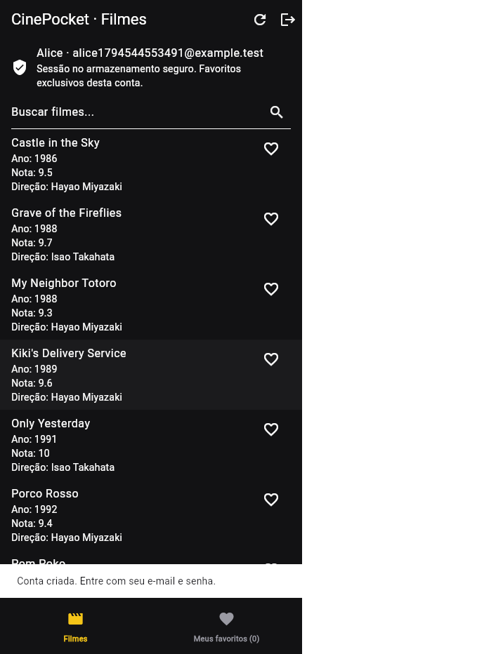

# CinePocket — Apresentação: Comunicação Segura com API REST e JWT

> **Integrantes:** João Gabriel · Lukas Sodré  
> **Escopo:** Issue #3 — Aplicativo Flutter com autenticação JWT, armazenamento seguro (`flutter_secure_storage`), comunicação HTTPS, tratamento de erros e API própria FastAPI + SQLite com favoritos isolados por usuário.

---

## Visão geral da arquitetura

```text
Flutter App (HTTPS) ──▶ API própria FastAPI + SQLite (Argon2id + JWT HS256)
                                │
                                └── HTTPS (sem repassar o JWT) ──▶ Studio Ghibli API
```

- O aplicativo **nunca fala diretamente** com a API pública sem autenticação nem usa dados mockados.
- Todas as operações do usuário (`/me`, `/movies`, `/favorites`) exigem `Authorization: Bearer <token>` lido do `flutter_secure_storage`.

---

## 1. Autenticação JWT e armazenamento seguro

**O que faz:**  
Na tela de login, o usuário informa e-mail e senha. O app envia um `POST /auth/login` em JSON por HTTPS, valida o formato do `access_token` recebido e salva o JWT no cofre seguro (`flutter_secure_storage`). A senha nunca é armazenada; se a gravação no cofre falhar, o usuário permanece no login.

**Trecho do código — Envio do login e navegação** ([lib/screens/login_screen.dart:53–72](../../lib/screens/login_screen.dart#L53-L72)):

```dart
Future<void> _login() async {
  if (_busy || !_form.currentState!.validate()) return;
  setState(() { _busy = true; _error = null; });
  try {
    await context.read<ApiService>().login(_email.text.trim(), _password.text);
    _password.clear();
    if (!mounted) return;
    ScaffoldMessenger.of(context).clearSnackBars();
    Navigator.of(context)
        .pushNamedAndRemoveUntil(RouteNames.consultation, (_) => false);
  } on ApiFailure catch (error) {
    if (mounted) setState(() => _error = error.message);
  } finally {
    if (mounted) setState(() => _busy = false);
  }
}
```

**Trecho do código — Extração do JWT e gravação segura** ([lib/services/api_service.dart:155–181](../../lib/services/api_service.dart#L155-L181)):

```dart
Future<void> login(String email, String password) async {
  final response = await _request('POST', loginPath,
      body: {'email': email, 'password': password});
  if (response.statusCode == 401 || response.statusCode == 403) {
    throw const ApiFailure('E-mail ou senha inválidos.');
  }
  _checkStatus(response);
  final json = _json(response);
  final token = json is Map<String, dynamic> ? json['access_token'] : null;
  if (token is! String ||
      token.isEmpty ||
      !RegExp(r'^[A-Za-z0-9_-]+\.[A-Za-z0-9_-]+\.[A-Za-z0-9_-]+$')
          .hasMatch(token)) {
    throw const ApiFailure('A API não retornou um JWT Access Token válido.');
  }
  try {
    await tokens.write(token);
    _blocked = false;
    currentUser = null;
    sessionVersion++;
    notifyListeners();
  } on Exception {
    _blocked = true;
    throw const ApiFailure(
        'Não foi possível salvar a sessão no armazenamento seguro. Tente entrar novamente.');
  }
}
```

**Trecho do código — Armazenamento com `flutter_secure_storage`** ([lib/services/api_service.dart:25–35](../../lib/services/api_service.dart#L25-L35)):

```dart
class SecureTokenStore implements TokenStore {
  final FlutterSecureStorage storage;
  SecureTokenStore({this.storage = const FlutterSecureStorage()});
  static const _key = 'cinepocket_access_token';
  @override
  Future<String?> read() => storage.read(key: _key);
  @override
  Future<void> write(String token) => storage.write(key: _key, value: token);
  @override
  Future<void> delete() => storage.delete(key: _key);
}
```

**Trecho do backend — Hash Argon2id e emissão do JWT** ([backend/app.py:198–209](../../backend/app.py#L198-L209)):

```python
@app.post('/auth/login', response_model=AccessToken)
def login(body: Credentials):
    with db() as connection:
        row = connection.execute('SELECT id, password_hash FROM users WHERE email = ?', (body.email,)).fetchone()
    valid = passwords.verify(body.password, row['password_hash'] if row else dummy_hash)
    if row is None or not valid:
        raise HTTPException(401, 'E-mail ou senha inválidos', headers={'WWW-Authenticate': 'Bearer'})
    now = datetime.now(timezone.utc)
    token = jwt.encode({'sub': row['id'], 'iat': now, 'exp': now + timedelta(seconds=ttl),
                        'iss': 'cinepocket-api', 'aud': 'cinepocket-app', 'jti': str(uuid4())},
                       secret, algorithm='HS256')
    return AccessToken(access_token=token, expires_in=ttl)
```

**Evidências:**
- Testes em [test/api_service_test.dart](../../test/api_service_test.dart#L42-L73) e [test/auth_flow_test.dart](../../test/auth_flow_test.dart#L54-L70) comprovam envio JSON, gravação no cofre, bloqueio de credenciais inválidas e permanência no login em caso de falha de gravação.
- Teste em [backend/tests/test_api.py](../../backend/tests/test_api.py#L59-L61) comprova armazenamento da senha com hash `$argon2id$` (nunca em texto puro).

---

## 2. Consulta protegida (`Authorization: Bearer`) e exibição dos dados

**O que faz:**  
Logo após autenticar, o app abre automaticamente a `ConsultationScreen`, lê o JWT do `flutter_secure_storage`, envia `Authorization: Bearer <token>` para `/me`, `/movies` e `/favorites`, desserializa o JSON com `Movie.fromJson` e exibe **4 atributos** por filme (título, ano, nota e direção — acima do mínimo de 3 exigido).

**Trecho do código — Desserialização JSON** ([lib/models/movie.dart:25–50](../../lib/models/movie.dart#L25-L50)):

```dart
factory Movie.fromJson(dynamic json) {
  if (json is! Map<String, dynamic> ||
      json['id'] is! String ||
      (json['id'] as String).isEmpty ||
      json['title'] is! String ||
      (json['title'] as String).trim().isEmpty ||
      json['year'] is! int ||
      json['rating'] is! num) {
    throw const FormatException();
  }
  return Movie(
    id: json['id'],
    title: json['title'],
    year: json['year'],
    rating: (json['rating'] as num).toDouble(),
    originalTitle: json['original_title'] is String ? json['original_title'] : '',
    director: json['director'] is String ? json['director'] : '',
    description: json['description'] is String ? json['description'] : '',
    duration: json['duration'] is String ? json['duration'] : '',
    genres: json['genres'] is List && (json['genres'] as List).every((g) => g is String)
        ? List<String>.from(json['genres'])
        : const [],
  );
}
```

**Trecho do código — Lista exibindo título, ano, nota e direção** ([lib/screens/consultation_screen.dart:200–206](../../lib/screens/consultation_screen.dart#L200-L206)):

```dart
child: ListTile(
  title: Text(movie.title,
      style: const TextStyle(fontWeight: FontWeight.w700)),
  subtitle: Text(
      'Ano: ${movie.year}\nNota: ${movie.rating}\nDireção: ${movie.director}'),
  isThreeLine: true,
```

**Evidência visual (execução real com a API HTTPS local):**



---

## 3. Token inválido ou expirado (HTTP 401)

**O que faz:**  
Quando qualquer requisição protegida retorna `401 Unauthorized`, o serviço apaga o token do armazenamento seguro, invalida a sessão/favoritos em memória e aciona o callback global `onSessionExpired`, que limpa toda a pilha de navegação (`pushNamedAndRemoveUntil`) e redireciona o usuário para o login.

**Trecho do código — Detecção do 401 e remoção do token** ([lib/services/api_service.dart:212–224](../../lib/services/api_service.dart#L212-L224)):

```dart
final response = await _request(method, path, token: token, body: body);
if (version != sessionVersion) throw const SessionExpired();
if (response.statusCode == 401) {
  String message = 'Sessão expirada. Entre novamente.';
  try {
    await logout();
  } on ApiFailure {
    message =
        'Sessão expirada. Falha ao remover o token do armazenamento seguro. Entre novamente ou tente limpar a sessão.';
  }
  onSessionExpired?.call(message);
  throw SessionExpired(message);
}
```

**Trecho do código — Redirecionamento global limpando a pilha** ([lib/main.dart:32–36](../../lib/main.dart#L32-L36)):

```dart
_api.onSessionExpired = (message) {
  _navigator.currentState?.pushNamedAndRemoveUntil(
      RouteNames.login, (_) => false,
      arguments: message);
};
```

**Evidências:**
- [test/auth_flow_test.dart](../../test/auth_flow_test.dart#L11-L52): simula expiração (401) ao favoritar, confirma `store.value == null`, remoção dos dados na tela e `canPop() == false` no login.
- [backend/tests/test_api.py](../../backend/tests/test_api.py#L64-L81): valida que requisições sem token, com token expirado, adulterado ou com `iss`/`aud` incorretos recebem `401`.

---

## 4. Comunicação HTTPS e armazenamento seguro

**O que faz:**  
O cliente rejeita qualquer URL sem `https://`, impede redirecionamentos automáticos (`followRedirects = false`) e não possui bypass de certificado. No Android, o manifesto bloqueia tráfego HTTP puro (`usesCleartextTraffic="false"`) e desativa backup (`allowBackup="false"`).

**Trecho do código — Validação estrita de HTTPS** ([lib/services/api_service.dart:92–116](../../lib/services/api_service.dart#L92-L116)):

```dart
Uri _endpoint(String path) {
  final base = Uri.tryParse(baseUrl);
  if (base == null ||
      base.scheme != 'https' ||
      base.host.isEmpty ||
      base.userInfo.isNotEmpty ||
      base.hasQuery ||
      base.hasFragment ||
      !path.startsWith('/') ||
      path.startsWith('//')) {
    throw const ApiFailure('Configure uma API HTTPS válida para continuar.');
  }
  // ...
}

final request = http.Request(method, _endpoint(path))
  ..followRedirects = false
  ..headers['Accept'] = 'application/json';
```

**Trecho de configuração — Android** ([android/app/src/main/AndroidManifest.xml:3–5](../../android/app/src/main/AndroidManifest.xml#L3-L5)):

```xml
<application
    android:allowBackup="false"
    android:usesCleartextTraffic="false"
```

### `SharedPreferences` × `flutter_secure_storage`

| Critério | `SharedPreferences` | `flutter_secure_storage` (usado no JWT) |
| --- | --- | --- |
| **Propósito** | Preferências simples e não sensíveis (tema, idioma, filtros, última pesquisa). | Segredos e credenciais (JWT Access Token). |
| **Proteção** | Armazenamento chave-valor comum sem cofre criptográfico gerenciado pelo sistema. | Usa recursos nativos de proteção da plataforma (Keychain em Apple e armazenamento criptografado com chaves protegidas em Android). |
| **Adequado para JWT?** | **Não** — expõe o token Bearer a extração indevida. | **Sim** — obrigatório no projeto para persistir o token. |

**HTTP em desenvolvimento vs. HTTPS em produção:**  
Usar HTTP expõe credenciais e tokens Bearer a interceptação e alteração em trânsito (MitM). Migrar para HTTPS em produção exige certificado público válido, configuração TLS no servidor/proxy e URLs `https://` sem desabilitar a verificação de certificados.

---

## 5. Tratamento de erros

**O que faz:**  
Todos os erros de transporte, contrato JSON, autenticação e armazenamento seguro são convertidos em mensagens claras (`ApiFailure`), sem travar o aplicativo nem expor stack traces ao usuário.

**Trecho do código — Rede, timeout, status HTTP e JSON** ([lib/services/api_service.dart:122–153](../../lib/services/api_service.dart#L122-L153)):

```dart
try {
  return await (() async {
    final response = await client.send(request);
    return http.Response.fromStream(response);
  })().timeout(timeout);
} on TimeoutException {
  throw const ApiFailure('Tempo de conexão esgotado. Tente novamente.');
} on Exception {
  throw const ApiFailure(
      'Servidor indisponível. Verifique sua conexão e tente novamente.');
}
```

| Cenário da Issue #3 | Comportamento implementado | Teste que comprova |
| --- | --- | --- |
| **Servidor indisponível** | Captura erro de rede/TLS e HTTP 5xx; exibe erro + botão *Tentar novamente*. | `api_service_test.dart` (`network failure`, `GET status 500/503`) |
| **Timeout de conexão** | Limite de 15s; exibe mensagem de tempo esgotado. | `api_service_test.dart` (`timeout`) |
| **Credenciais inválidas** | HTTP 401/403 no login; mantém formulário sem gravar sessão. | `api_service_test.dart` (`invalid credentials are not stored`) |
| **Token expirado** | HTTP 401 em rota protegida; apaga token e retorna ao login. | `api_service_test.dart`, `auth_flow_test.dart` |
| **JSON inválido** | Captura `FormatException` ou payload fora do contrato. | `api_service_test.dart` (`invalid movie/login payload`) |
| **Falha no armazenamento seguro** | Trata erros de leitura, gravação e exclusão (com bloqueio local `_blocked = true`). | `api_service_test.dart`, `auth_flow_test.dart` |

---

## 6. Análise de criptografia adicional (`Encrypt`)

- **HTTPS já protege o tráfego?** Sim: TLS garante confidencialidade, integridade e autenticação do servidor em trânsito. Porém, não protege dados após a terminação TLS (banco, logs, dispositivo comprometido) — e JWT assinado não é criptografado.
- **Quando usar o pacote `Encrypt`?** Quando for necessário manter arquivos/campos sensíveis cifrados fora do cofre seguro ou conteúdo sigiloso ponta a ponta que nem intermediários ou o próprio servidor devam ler (exigindo gerenciamento seguro de chaves por usuário, rotação e nonces).
- **Vantagens:** proteção adicional do conteúdo além do canal TLS.
- **Desvantagens:** complexidade de gestão/recuperação de chaves, maior payload/processamento, dificuldade de busca no servidor e alto risco de falhas de implementação.
- **Decisão técnica:** **não adotar `Encrypt` neste projeto.** HTTPS protege os dados em trânsito e `flutter_secure_storage` protege o JWT em repouso; embutir uma chave fixa no app não traria segurança real.

*(Análise detalhada completa em [docs/justificativas/comunicacao-segura.md](../justificativas/comunicacao-segura.md).)*

---

## 7. Isolamento de favoritos por usuário (API própria)

**O que faz:**  
Na API FastAPI, cada rota protegida identifica o usuário exclusivamente pelo campo `sub` do JWT validado. O cliente não pode informar `user_id`, e ao trocar de conta ou sair, `FavoritesProvider` limpa o cache em memória automaticamente.

**Trecho do backend — Identificação pelo JWT** ([backend/app.py:161–175](../../backend/app.py#L161-L175)):

```python
def current_user(credentials: Annotated[HTTPAuthorizationCredentials | None, Depends(bearer)]):
    if credentials is None or credentials.scheme.lower() != 'bearer':
        raise unauthorized()
    try:
        claims = jwt.decode(credentials.credentials, secret, algorithms=['HS256'],
                            issuer='cinepocket-api', audience='cinepocket-app',
                            options={'require': ['sub', 'exp', 'iat', 'iss', 'aud', 'jti']})
        uid = str(UUID(claims['sub']))
    except (jwt.InvalidTokenError, ValueError, TypeError, KeyError) as error:
        raise unauthorized() from error
    with db() as connection:
        row = connection.execute('SELECT id, name, email FROM users WHERE id = ?', (uid,)).fetchone()
    if row is None:
        raise unauthorized()
    return User(**dict(row))
```

**Evidências:**
- [test/widget_test.dart](../../test/widget_test.dart#L11-L76): fluxo completo Conta A favorita → logout → Conta B vê 0 favoritos → Conta A entra novamente e recupera seu favorito.
- [backend/tests/test_api.py](../../backend/tests/test_api.py#L36-L62): testa isolamento entre Alice e Bob, persistência após recriar a API e rejeição de tentativa de escolher outro `user_id` (`422`).

---

## 8. Evidências de validação automatizada

Todas as verificações abaixo foram executadas sobre o estado atual do repositório:

| Verificação | Comando | Resultado |
| --- | --- | --- |
| **Análise estática Flutter** | `flutter analyze` | `No issues found!` (0 avisos/erros) |
| **Testes Flutter (unidade + widget)** | `flutter test` | **35/35 testes aprovados** (`api_service_test`, `auth_flow_test`, `public_api_test`, `screens_ux_test`, `widget_test`) |
| **Testes da API FastAPI** | `python -m pytest backend/tests -v` | **8/8 testes aprovados** (`backend/tests/test_api.py`) |

### Nota transparente de escopo
- Os testes automatizados do Flutter utilizam `MockClient` e `MemoryTokens` (implementação em memória de `TokenStore`), e a captura de tela acima foi feita no Flutter Web conectado à API HTTPS local (`https://localhost:8443`).
- A validação do cofre nativo (`Keystore` no Android e `Keychain` no iOS) depende da execução em emulador ou aparelho físico.
