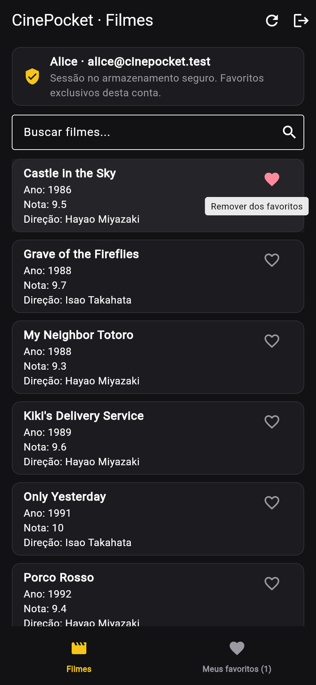

# Implementação de Comunicação Segura — CinePocket

> **Integrantes:** João Gabriel · Lukas Sodré  
> **Escopo:** Issue #3 — Aplicativo Flutter com autenticação JWT, armazenamento seguro (`flutter_secure_storage`), comunicação HTTPS, tratamento de erros, análise de criptografia adicional (`Encrypt`) e API própria FastAPI + SQLite com favoritos isolados por usuário.

---

## Visão geral da arquitetura

```text
Flutter App (HTTPS) ──▶ API própria FastAPI + SQLite (Argon2id + JWT HS256)
                                │
                                └── HTTPS (sem repassar o JWT) ──▶ Studio Ghibli API
```

- O aplicativo **nunca fala diretamente** com a API pública sem autenticação nem usa dados mockados. A solução anterior baseada em DummyJSON foi substituída porque não persistia os favoritos reais do CinePocket por conta.
- Todas as operações do usuário (`/me`, `/movies`, `/favorites`) exigem `Authorization: Bearer <token>` lido do `flutter_secure_storage`.
- Para executar a API HTTPS local e consultar o contrato completo dos endpoints, consulte [backend/README.md](../../backend/README.md).

**Dependências do cliente Flutter** ([pubspec.yaml:9–14](../../pubspec.yaml#L9-L14)):

```yaml
dependencies:
  flutter:
    sdk: flutter
  provider: ^6.1.2
  http: ^1.6.0
  flutter_secure_storage: ^10.0.0
```

**Fluxo completo:**
1. Criar conta (`POST /auth/register`): a API armazena o hash **Argon2id** da senha.
2. Fazer login (`POST /auth/login` via HTTPS, corpo JSON) com e-mail e senha.
3. Extrair `access_token` e gravá-lo em `flutter_secure_storage`. Se a gravação falhar, o usuário permanece no login. A senha nunca é persistida.
4. Abrir automaticamente a tela de consulta protegida (`ConsultationScreen`), enviando `Authorization: Bearer <token>` em `/me`, `/movies` e `/favorites`.
5. Adicionar/remover favoritos pelo ID do filme: a API identifica o dono exclusivamente pelo `sub` do JWT validado.
6. Sair ou receber HTTP `401` limpa o token, a identidade e os favoritos em memória, retornando ao login e limpando toda a pilha de navegação.
7. Ao reabrir o aplicativo, um token armazenado é revalidado no servidor; ao entrar novamente na mesma conta, os favoritos persistidos no SQLite são recarregados.

---

## 1. Autenticação JWT e armazenamento seguro

**O que faz:**  
Na tela de login (`LoginScreen`), o usuário informa e-mail e senha (também podendo criar conta em `RegisterScreen` ou limpar uma sessão armazenada). O aplicativo envia `POST /auth/login` em JSON por HTTPS, valida a estrutura do JWT em `access_token` e grava o token no cofre seguro (`flutter_secure_storage`). Se a gravação falhar, a sessão é bloqueada e o usuário permanece no login.

**Trecho do código — Envio do login e navegação** ([lib/screens/login_screen.dart:53–73](../../lib/screens/login_screen.dart#L53-L73)):

```dart
Future<void> _login() async {
  if (_busy || !_form.currentState!.validate()) return;
  setState(() {
    _busy = true;
    _error = null;
  });
  try {
    await context
        .read<ApiService>()
        .login(_email.text.trim(), _password.text);
    _password.clear();
    if (!mounted) return;
    ScaffoldMessenger.of(context).clearSnackBars();
    Navigator.of(context)
        .pushNamedAndRemoveUntil(RouteNames.consultation, (_) => false);
  } on ApiFailure catch (error) {
    if (mounted) setState(() => _error = error.message);
  } finally {
    if (mounted) setState(() => _busy = false);
  }
}
```

**Trecho do código — Extração do JWT e gravação segura** ([lib/services/api_service.dart:155–181](../../lib/services/api_service.dart#L155-L181)):

```dart
Future<void> login(String email, String password) async {
  final response = await _request('POST', loginPath,
      body: {'email': email, 'password': password});
  if (response.statusCode == 401 || response.statusCode == 403) {
    throw const ApiFailure('E-mail ou senha inválidos.');
  }
  _checkStatus(response);
  final json = _json(response);
  final token = json is Map<String, dynamic> ? json['access_token'] : null;
  if (token is! String ||
      token.isEmpty ||
      !RegExp(r'^[A-Za-z0-9_-]+\.[A-Za-z0-9_-]+\.[A-Za-z0-9_-]+$')
          .hasMatch(token)) {
    throw const ApiFailure('A API não retornou um JWT Access Token válido.');
  }
  try {
    await tokens.write(token);
    _blocked = false;
    currentUser = null;
    sessionVersion++;
    notifyListeners();
  } on Exception {
    _blocked = true;
    throw const ApiFailure(
        'Não foi possível salvar a sessão no armazenamento seguro. Tente entrar novamente.');
  }
}
```

**Trecho do código — Armazenamento com `flutter_secure_storage`** ([lib/services/api_service.dart:19–35](../../lib/services/api_service.dart#L19-L35)):

```dart
abstract class TokenStore {
  Future<String?> read();
  Future<void> write(String token);
  Future<void> delete();
}

class SecureTokenStore implements TokenStore {
  final FlutterSecureStorage storage;
  SecureTokenStore({this.storage = const FlutterSecureStorage()});
  static const _key = 'cinepocket_access_token';
  @override
  Future<String?> read() => storage.read(key: _key);
  @override
  Future<void> write(String token) => storage.write(key: _key, value: token);
  @override
  Future<void> delete() => storage.delete(key: _key);
}
```

**Trecho do backend — Hash Argon2id e emissão do JWT** ([backend/app.py:198–209](../../backend/app.py#L198-L209)):

```python
@app.post('/auth/login', response_model=AccessToken)
def login(body: Credentials):
    with db() as connection:
        row = connection.execute('SELECT id, password_hash FROM users WHERE email = ?', (body.email,)).fetchone()
    valid = passwords.verify(body.password, row['password_hash'] if row else dummy_hash)
    if row is None or not valid:
        raise HTTPException(401, 'E-mail ou senha inválidos', headers={'WWW-Authenticate': 'Bearer'})
    now = datetime.now(timezone.utc)
    token = jwt.encode({'sub': row['id'], 'iat': now, 'exp': now + timedelta(seconds=ttl),
                        'iss': 'cinepocket-api', 'aud': 'cinepocket-app', 'jti': str(uuid4())},
                       secret, algorithm='HS256')
    return AccessToken(access_token=token, expires_in=ttl)
```

**Evidências nos testes:**
- [test/api_service_test.dart](../../test/api_service_test.dart#L42-L73) (login e credenciais inválidas), [test/api_service_test.dart](../../test/api_service_test.dart#L107-L123) (erros de leitura/gravação no armazenamento) e [test/auth_flow_test.dart](../../test/auth_flow_test.dart#L54-L70) comprovam envio JSON, gravação no cofre, bloqueio de credenciais inválidas e permanência no login em caso de falha de gravação.
- [backend/tests/test_api.py](../../backend/tests/test_api.py#L59-L61) comprova armazenamento da senha com hash `$argon2id$` (nunca em texto puro).

---

## 2. Consulta protegida (`Authorization: Bearer`) e exibição dos dados

**O que faz:**  
Logo após autenticar (ou restaurar uma sessão existente), o aplicativo abre automaticamente a `ConsultationScreen`, lê o JWT do `flutter_secure_storage`, envia `Authorization: Bearer <token>` para `/me`, `/movies` e `/favorites`, desserializa o JSON com `Movie.fromJson` e exibe **4 atributos** por filme (título, ano, nota e direção — acima do mínimo de 3 exigido pela issue), além da identidade da conta autenticada.

**Trecho do código — Desserialização JSON** ([lib/models/movie.dart:25–50](../../lib/models/movie.dart#L25-L50)):

```dart
factory Movie.fromJson(dynamic json) {
  if (json is! Map<String, dynamic> ||
      json['id'] is! String ||
      (json['id'] as String).isEmpty ||
      json['title'] is! String ||
      (json['title'] as String).trim().isEmpty ||
      json['year'] is! int ||
      json['rating'] is! num) {
    throw const FormatException();
  }
  return Movie(
    id: json['id'],
    title: json['title'],
    year: json['year'],
    rating: (json['rating'] as num).toDouble(),
    originalTitle:
        json['original_title'] is String ? json['original_title'] : '',
    director: json['director'] is String ? json['director'] : '',
    description: json['description'] is String ? json['description'] : '',
    duration: json['duration'] is String ? json['duration'] : '',
    genres: json['genres'] is List &&
            (json['genres'] as List).every((g) => g is String)
        ? List<String>.from(json['genres'])
        : const [],
  );
}
```

**Trecho do código — Lista exibindo título, ano, nota e direção** ([lib/screens/consultation_screen.dart:200–206](../../lib/screens/consultation_screen.dart#L200-L206)):

```dart
child: ListTile(
  title: Text(movie.title,
      style: const TextStyle(
          fontWeight: FontWeight.w700)),
  subtitle: Text(
      'Ano: ${movie.year}\nNota: ${movie.rating}\nDireção: ${movie.director}'),
  isThreeLine: true,
```

**Evidência visual (execução real no Flutter Web conectado à API HTTPS local em `https://localhost:8443`):**



---

## 3. Token inválido ou expirado (HTTP 401)

**O que faz:**  
Quando qualquer requisição protegida retorna `401 Unauthorized`, o serviço apaga o token do armazenamento seguro via `logout()`, limpa a identidade e os favoritos em memória (incrementando `sessionVersion`) e dispara o callback global `onSessionExpired`, que remove toda a pilha de navegação (`pushNamedAndRemoveUntil`) e redireciona o usuário para o login. Caso a exclusão do cofre falhe, a flag `_blocked = true` impede a reutilização do token na execução atual e orienta nova tentativa.

**Trecho do código — Detecção do 401 e remoção do token** ([lib/services/api_service.dart:212–224](../../lib/services/api_service.dart#L212-L224)):

```dart
final response = await _request(method, path, token: token, body: body);
if (version != sessionVersion) throw const SessionExpired();
if (response.statusCode == 401) {
  String message = 'Sessão expirada. Entre novamente.';
  try {
    await logout();
  } on ApiFailure {
    message =
        'Sessão expirada. Falha ao remover o token do armazenamento seguro. Entre novamente ou tente limpar a sessão.';
  }
  onSessionExpired?.call(message);
  throw SessionExpired(message);
}
```

**Trecho do código — Redirecionamento global limpando a pilha** ([lib/main.dart:32–36](../../lib/main.dart#L32-L36)):

```dart
_api.onSessionExpired = (message) {
  _navigator.currentState?.pushNamedAndRemoveUntil(
      RouteNames.login, (_) => false,
      arguments: message);
};
```

**Evidências nos testes:**
- [test/auth_flow_test.dart](../../test/auth_flow_test.dart#L11-L52): simula expiração (`401`) ao favoritar, confirma `store.value == null`, remoção dos dados na tela e `canPop() == false` no login.
- [backend/tests/test_api.py](../../backend/tests/test_api.py#L64-L81): valida que requisições sem token, com token expirado, adulterado ou com `iss`/`aud` incorretos recebem `401`.

---

## 4. Comunicação HTTPS e armazenamento seguro

**O que faz:**  
Todas as chamadas REST do Flutter e a consulta do backend ao catálogo Studio Ghibli utilizam HTTPS. O cliente rejeita qualquer URL sem `https://`, impede redirecionamentos automáticos (`followRedirects = false`) e não possui bypass de validação de certificados. No Android, o manifesto bloqueia tráfego HTTP puro (`usesCleartextTraffic="false"`) e desativa backup automático (`allowBackup="false"`). Nas plataformas Apple, os entitlements de Keychain e rede cliente estão configurados em [ios/Runner/Runner.entitlements](../../ios/Runner/Runner.entitlements), [macos/Runner/DebugProfile.entitlements](../../macos/Runner/DebugProfile.entitlements) e [macos/Runner/Release.entitlements](../../macos/Runner/Release.entitlements).

**Trecho do código — Validação estrita de HTTPS** ([lib/services/api_service.dart:92–116](../../lib/services/api_service.dart#L92-L116)):

```dart
Uri _endpoint(String path) {
  final base = Uri.tryParse(baseUrl);
  if (base == null ||
      base.scheme != 'https' ||
      base.host.isEmpty ||
      base.userInfo.isNotEmpty ||
      base.hasQuery ||
      base.hasFragment ||
      !path.startsWith('/') ||
      path.startsWith('//')) {
    throw const ApiFailure('Configure uma API HTTPS válida para continuar.');
  }
  // ...
}

final request = http.Request(method, _endpoint(path))
  ..followRedirects = false
  ..headers['Accept'] = 'application/json';
```

**Trecho de configuração — Android** ([android/app/src/main/AndroidManifest.xml:1–8](../../android/app/src/main/AndroidManifest.xml#L1-L8)):

```xml
<manifest xmlns:android="http://schemas.android.com/apk/res/android">
    <uses-permission android:name="android.permission.INTERNET" />
    <application
        android:allowBackup="false"
        android:usesCleartextTraffic="false"
        android:label="cinepocket"
        android:name="${applicationName}"
        android:icon="@mipmap/ic_launcher">
```

### Análise: HTTP em desenvolvimento vs. HTTPS em produção
- **Proteção do TLS:** garante confidencialidade e integridade dos dados em trânsito (senha no login, cabeçalho `Authorization: Bearer` e payloads JSON) e autentica o servidor por certificado confiável.
- **Risco do HTTP:** se o desenvolvimento usasse HTTP puro, credenciais e tokens poderiam ser interceptados ou alterados em trânsito (ataque *Man-in-the-Middle*). Um redirecionamento posterior para HTTPS não desfaz o vazamento da requisição HTTP inicial.
- **Migração para produção:** exige certificado público válido com renovação apropriada, configuração TLS no servidor/proxy reverso e URLs `https://` no cliente sem aceitar certificados inválidos. O backend pode escutar HTTP apenas em loopback atrás de um proxy TLS, mas qualquer trecho em rede não confiável precisa de TLS.

### Análise: `SharedPreferences` × `flutter_secure_storage`

| Critério | `SharedPreferences` | `flutter_secure_storage` (adotado para o JWT) |
| --- | --- | --- |
| **Propósito** | Preferências simples e não sensíveis da interface: tema, idioma, filtros visuais e última pesquisa não confidencial. | Armazenamento de segredos e credenciais (como o JWT Access Token). |
| **Mecanismo de proteção** | Armazenamento chave-valor comum sem cofre criptográfico gerenciado pelo sistema operacional. | Utiliza recursos nativos de proteção da plataforma (Keychain em Apple e armazenamento criptografado com proteção de chaves em Android). Na Web depende do navegador, exige HTTPS/`localhost` e não elimina riscos de XSS. |
| **Adequado para JWT/senhas?** | **Não.** Como o JWT é uma credencial *Bearer* (quem o obtém age como o usuário), armazená-lo sem proteção expõe a sessão a extração indevida. | **Sim.** Obrigatório para persistir o token; não é necessário instalar `shared_preferences` no projeto apenas para esta comparação. |

---

## 5. Tratamento de erros

**O que faz:**  
Todos os erros de transporte, contrato JSON, autenticação e armazenamento seguro são convertidos em mensagens claras (`ApiFailure`), sem travar a interface nem expor stack traces ao usuário. Alterações locais de favoritos nunca são confirmadas sem resposta de sucesso do servidor, e respostas atrasadas de uma sessão anterior são descartadas após troca de conta (`sessionVersion`).

**Trecho do código — Rede, timeout, status HTTP e JSON** ([lib/services/api_service.dart:122–153](../../lib/services/api_service.dart#L122-L153)):

```dart
try {
  return await (() async {
    final response = await client.send(request);
    return http.Response.fromStream(response);
  })()
      .timeout(timeout);
} on TimeoutException {
  throw const ApiFailure('Tempo de conexão esgotado. Tente novamente.');
} on Exception {
  throw const ApiFailure(
      'Servidor indisponível. Verifique sua conexão e tente novamente.');
}

// ...

dynamic _json(http.Response response) {
  try {
    return jsonDecode(utf8.decode(response.bodyBytes));
  } on FormatException {
    throw const ApiFailure('A API retornou uma resposta JSON inválida.');
  }
}

void _checkStatus(http.Response response) {
  if (response.statusCode >= 500) {
    throw const ApiFailure(
        'Servidor indisponível. Tente novamente mais tarde.');
  }
  if (response.statusCode < 200 || response.statusCode >= 300) {
    throw ApiFailure(
        'Não foi possível concluir a requisição (${response.statusCode}).');
  }
}
```

| Cenário da Issue #3 | Comportamento implementado | Teste que comprova |
| --- | --- | --- |
| **Servidor indisponível** | Captura falhas de rede/DNS/TLS e HTTP `5xx`; exibe aviso + botão *Tentar novamente*. | `api_service_test.dart` (`network failure`, `GET status 500/503`) |
| **Timeout de conexão** | Limite de 15 segundos; exibe mensagem de tempo esgotado. | `api_service_test.dart` (`timeout`) |
| **Credenciais inválidas** | HTTP `401`/`403` no login; mantém formulário com aviso e não grava sessão. | `api_service_test.dart` (`invalid credentials are not stored`) |
| **Token inválido/expirado** | HTTP `401` em rota protegida; apaga token, limpa cache e retorna ao login. | `api_service_test.dart`, `auth_flow_test.dart` |
| **Resposta JSON inválida** | Captura `FormatException` ou estrutura fora do contrato (`Movie`/`SessionUser`/`access_token`). | `api_service_test.dart` (`invalid movie/login payload`) |
| **Falha no armazenamento seguro** | Trata erros de leitura (não envia requisição), gravação (permanece no login) e exclusão (bloqueia reutilização local via `_blocked = true`). | `api_service_test.dart`, `auth_flow_test.dart` |
| **Falha ao salvar favorito** | Não altera a lista local sem sucesso do servidor (`204`). | `public_api_test.dart` (`failed write on server`) |

---

## 6. Análise de criptografia adicional (pacote `Encrypt`)

- **O HTTPS já protege os dados transmitidos?**  
  Sim. O TLS protege confidencialidade, integridade e autenticidade do servidor durante o transporte entre cliente e API. Porém, o TLS termina no servidor/proxy: não protege automaticamente dados já gravados em banco, logs ou abertos em memória — além disso, um JWT assinado (JWS) garante integridade, mas seu payload não é criptografado.
- **Quando uma camada adicional com `Encrypt` seria necessária?**  
  Quando houver requisito explícito de manter arquivos/campos confidenciais cifrados fora do cofre seguro, conteúdo sensível que deva permanecer opaco a proxies/intermediários após a terminação TLS, ou comunicação ponta a ponta (*E2EE*) que nem mesmo o servidor possa ler. Isso exigiria protocolo interoperável, criptografia autenticada, chaves por usuário, distribuição, rotação, recuperação e nonces corretos — instalar um pacote não cria essas garantias sozinho.
- **Vantagens:** proteção adicional do conteúdo além do canal TLS e menor exposição em intermediários ou armazenamentos secundários.
- **Desvantagens:** alta complexidade de gestão/rotação/recuperação de chaves, maior custo de processamento e tamanho de payload, dificuldade de busca/indexação no servidor e risco elevado de vulnerabilidades por erro de implementação.
- **Decisão técnica adotada:** **não utilizar o pacote `Encrypt` neste projeto.** HTTPS protege adequadamente os dados em trânsito e `flutter_secure_storage` protege o JWT em repouso. Não há requisito de cifrar o catálogo público ou a lista de favoritos ponta a ponta, e embutir uma chave fixa no aplicativo seria facilmente extraível, gerando falsa sensação de segurança. `Encrypt` não substitui HTTPS, autorização no servidor nem armazenamento seguro.

---

## 7. Isolamento de favoritos por usuário e padrões de projeto

**O que faz:**  
Na API FastAPI ([backend/app.py](../../backend/app.py)), toda rota protegida valida assinatura `HS256`, expiração (`exp`), emissão (`iat`), emissor (`cinepocket-api`), audiência (`cinepocket-app`), `jti` e existência da conta no SQLite. O dono do favorito vem exclusivamente de `sub` — qualquer tentativa de enviar `user_id` no corpo é rejeitada (`extra='forbid'` → `422`). No Flutter, `FavoritesProvider` limpa o cache em memória automaticamente ao trocar de conta ou sair.

**Trecho do backend — Validação estrita do JWT e identificação do usuário** ([backend/app.py:161–177](../../backend/app.py#L161-L177)):

```python
    def current_user(credentials: Annotated[HTTPAuthorizationCredentials | None, Depends(bearer)]):
        if credentials is None or credentials.scheme.lower() != 'bearer':
            raise unauthorized()
        try:
            claims = jwt.decode(credentials.credentials, secret, algorithms=['HS256'],
                                issuer='cinepocket-api', audience='cinepocket-app',
                                options={'require': ['sub', 'exp', 'iat', 'iss', 'aud', 'jti']})
            uid = str(UUID(claims['sub']))
        except (jwt.InvalidTokenError, ValueError, TypeError, KeyError) as error:
            raise unauthorized() from error
        with db() as connection:
            row = connection.execute('SELECT id, name, email FROM users WHERE id = ?', (uid,)).fetchone()
        if row is None:
            raise unauthorized()
        return User(**dict(row))

    AuthUser = Annotated[User, Depends(current_user)]
```

**Padrões de projeto adotados:**
- **Factory (`Factory Constructor` e `Application Factory`):** `Movie.fromJson` ([lib/models/movie.dart:25–50](../../lib/models/movie.dart#L25-L50)), `SessionUser.fromJson` ([lib/services/api_service.dart:42–52](../../lib/services/api_service.dart#L42-L52)) e `create_app(...)` ([backend/app.py:112–244](../../backend/app.py#L112-L244)) centralizam validação estrutural e instanciação configurável para execução local e testes isolados.
- **Strategy / Injeção de Dependência:** `TokenStore` ([lib/services/api_service.dart:19–35](../../lib/services/api_service.dart#L19-L35)) e `http.Client` desacoplam as regras de sessão do armazenamento real (`SecureTokenStore`) e permitem injetar `MemoryTokens` e `MockClient` nos testes automatizados.
- **Observer (`ChangeNotifier` + `Provider`):** `ApiService` notifica `FavoritesProvider` ([lib/providers/favorites_provider.dart:11–21](../../lib/providers/favorites_provider.dart#L11-L21)) a cada mudança de `sessionVersion`, limpando imediatamente o cache da conta anterior.

**Evidências nos testes:**
- [test/widget_test.dart](../../test/widget_test.dart#L11-L76): fluxo completo Conta A favorita → logout → Conta B vê `0` favoritos → Conta A entra novamente e recupera seu favorito.
- [backend/tests/test_api.py](../../backend/tests/test_api.py#L36-L62) e [backend/tests/test_api.py](../../backend/tests/test_api.py#L94-L101): isolamento entre Alice e Bob, persistência após recriar a API e rejeição de tentativa de escolher outro `user_id` (`422`).

---

## 8. Evidências de validação, dificuldades e limitações

| Verificação | Comando | Resultado |
| --- | --- | --- |
| **Análise estática Flutter** | `flutter analyze` | `No issues found!` (0 erros/avisos) |
| **Testes Flutter (unidade + widget)** | `flutter test` | **35/35 testes aprovados** ([api_service_test.dart](../../test/api_service_test.dart), [auth_flow_test.dart](../../test/auth_flow_test.dart), [public_api_test.dart](../../test/public_api_test.dart), [screens_ux_test.dart](../../test/screens_ux_test.dart), [widget_test.dart](../../test/widget_test.dart)) |
| **Build Web Flutter** | `flutter build web` | Compilação concluída sem erros (`✓ Built build/web`) |
| **Testes da API FastAPI** | `python -m pytest backend/tests -v` | **8/8 testes aprovados** ([backend/tests/test_api.py](../../backend/tests/test_api.py)) |

### Dificuldades encontradas e limitações registradas
- **Integração catálogo público + contas privadas:** combinar a API pública Studio Ghibli com autenticação própria exigiu IDs estáveis de filmes, persistência relacional em SQLite e limpeza determinística do cache ao trocar de conta.
- **Certificados locais e cofre nativo:** certificados locais autoassinados exigem confiança explícita no cliente/dispositivo (o código Flutter não contém bypass TLS). Nos testes automatizados do Flutter, usa-se `MockClient` e `MemoryTokens`; a captura acima comprova o fluxo ponta a ponta no Flutter Web com a API HTTPS local, enquanto a validação do cofre nativo (`Keystore` no Android e `Keychain` no iOS) depende de execução em emulador ou aparelho físico.
- **Escopo didático da API:** o servidor local (`127.0.0.1:8443`) não implementa refresh token, revogação de JWT no servidor ou recuperação de senha.

### Referências técnicas
- [FastAPI: OAuth2 com JWT e hash de senhas](https://fastapi.tiangolo.com/tutorial/security/oauth2-jwt/)
- [PyJWT: validação de claims](https://pyjwt.readthedocs.io/en/latest/api.html)
- [flutter_secure_storage](https://pub.dev/packages/flutter_secure_storage)
- [SharedPreferences](https://pub.dev/packages/shared_preferences)
- [Catálogo Studio Ghibli API](https://ghibliapi.vercel.app/)
