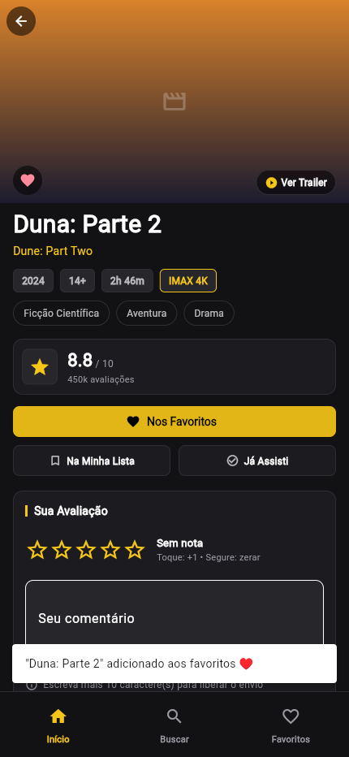
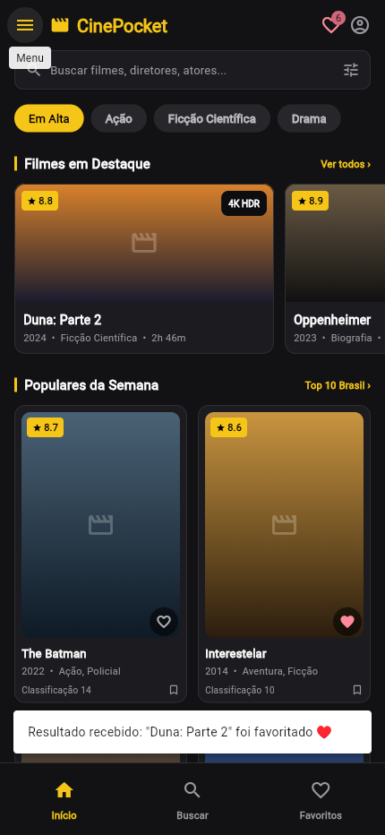
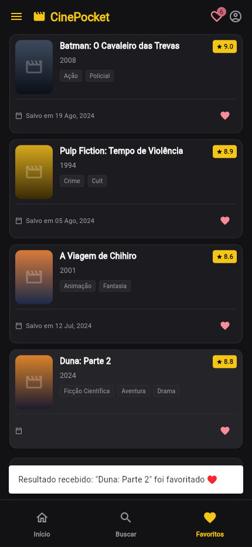

# Implementação da gerência de estado

## Abordagem escolhida

Provider + ChangeNotifier. O FavoritesProvider, separado da UI em lib/providers/favorites_provider.dart, é a fonte única dos favoritos da sessão. O ChangeNotifierProvider envolve o aplicativo em lib/main.dart.

## Justificativa da escolha

Provider permite compartilhar o estado com pouca estrutura e sem geração de código, adequado ao tamanho deste aplicativo. Cubit também resolveria o problema, mas introduziria a estrutura e os conceitos do Bloc sem necessidade neste escopo. MobX exigiria stores observáveis e geração de código. Provider foi escolhido pela simplicidade de leitura e manutenção.

## Antes: estado local com setState

Na versão original do PR (commit 181f093817af622b0ddd1f008037cdda6ea35be9), a tela de detalhes guardava bool _favorite e alterava esse valor com setState. Favoritar Duna atualizava o coração e o botão daquela tela, mas o contador da AppBar continuava em 5 e a lista de favoritos continuava fixa. O PR já possuía Provider nos cards da Home e no contador; estas capturas documentam a parte local que ainda precisava ser migrada, conforme a refatoração parcial permitida na atividade.

## Depois: estado compartilhado e reativo

O provider mantém um mapa de filmes, identificado pelo título no catálogo simulado, e expõe count, movies, isFavorite, setFavorite e toggleFavorite. A lista retornada é imutável. As operações adicionam ou removem um filme e chamam notifyListeners somente quando há alteração.

A Home e a AppBar usam Consumer. Meus Favoritos e a tela de detalhes usam context.watch para reconstruir a UI, e context.read nos comandos. Favoritar nos detalhes, dar uma avaliação alta ou limpar tudo modifica o mesmo provider. Também é possível remover um filme diretamente da lista. Ao reabrir os detalhes, o favorito é consultado na fonte compartilhada.

O estado do formulário (texto, nota ainda não enviada e carregamento) permanece local. A refatoração parcial migra os favoritos, compartilhados entre as telas; não é necessário globalizar cada estado efêmero de interação.

## Principal dificuldade

Identificar todos os caminhos que alteravam favoritos: botão dos cards, botão e gesto nos detalhes, avaliação com nota alta e limpeza. Manter uma variável local nos detalhes produziria duas fontes de verdade. A solução foi centralizar as operações no provider e consumir a mesma instância acima dos navegadores das abas.

## Vantagem sobre setState

Uma alteração atualiza os widgets interessados em telas distintas sem passar listas e callbacks pela navegação. A regra de favoritos pode ser exercitada independentemente da apresentação e fica concentrada em uma classe.

## Validação e requisitos

1. Estado separado da UI: FavoritesProvider estende ChangeNotifier.
2. Consumo apropriado: Consumer e context.watch.
3. Reatividade em múltiplos locais: coração/botão, contador e lista de favoritos.
4. Modificação pela UI: favoritar nos cards e detalhes, remover na lista.
5. Separação de responsabilidades: operações de favoritos no provider; widgets apresentam o estado e disparam comandos.

O fluxo foi executado em Flutter Web no Chromium, com janela de 430 x 932, em 7 de novembro de 2026. Primeiro foi capturado o comportamento original do PR; depois, o mesmo fluxo refatorado. As imagens são capturas reais do aplicativo executado.

Testes automatizados: navegação de detalhes e retorno; navegação entre abas e drawer; inclusão de Duna nos detalhes, atualização da lista compartilhada e remoção pela lista. Resultado: 3 testes aprovados e flutter analyze sem problemas. Ambiente: Flutter 3.47.9 e Dart 3.13.7. Comandos: flutter test e flutter analyze.

Os favoritos começam com 5 filmes simulados e duram apenas durante a sessão. Não há persistência em disco ou API. O título identifica o filme neste catálogo simples; uma API real deverá fornecer um ID estável.

## Execução em contêiner

Use o Dockerfile.flutter na raiz: docker build -f Dockerfile.flutter -t cinepocket-flutter . e docker run --rm -p 8080:8080 cinepocket-flutter. Abra http://localhost:8080. Para testar: docker run --rm cinepocket-flutter flutter test. Para analisar: docker run --rm cinepocket-flutter flutter analyze.

Em redes com proxy corporativo, configure o proxy e os certificados de confiança no contêiner conforme seu ambiente. A validação desta entrega utilizou um contêiner Ubuntu 24.04 com Flutter instalado, cache e fonte do projeto montados no espaço de trabalho.

[PDF comparativo para entrega](comparativo-estado-global.pdf)
